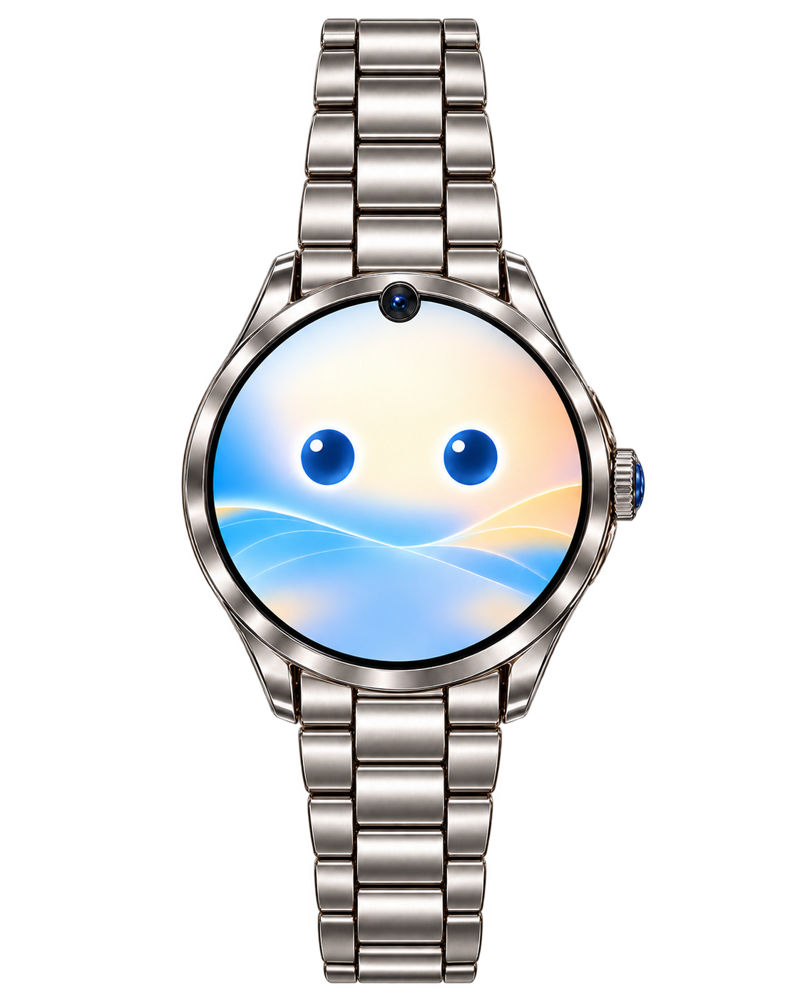

# COMPIO

**A connected companion product concept spanning wearable hardware, app experience, and brand design.**

[RawPowered project portfolio](https://github.com/RawPowered)

---

## Project overview

<em>Watch concept. It does not represent a manufactured or clinically validated device.</em>

COMPIO explores a connected watch and companion app designed around everyday health and care routines. The project brings wearable product concepts together with mobile interfaces, supporting service ideas, and a unified visual identity.

The work demonstrates product concept development across physical form, companion interactions, brand direction, and cross-device experience.

## Areas represented

- Watch form, materials, and interaction concepts
- Companion app flows and interface design
- Brand identity and product presentation
- Connections between wearable, app, and support experience

## Project status

COMPIO is presented as a product concept. The visuals and materials describe design direction and exploration; they do not indicate a manufactured device, clinical validation, or a released service. Any future showcase examples will be selected and labeled by development stage.

## Evidence

Selected product renders, app screens, and a concise system overview will be added after review for public display.
